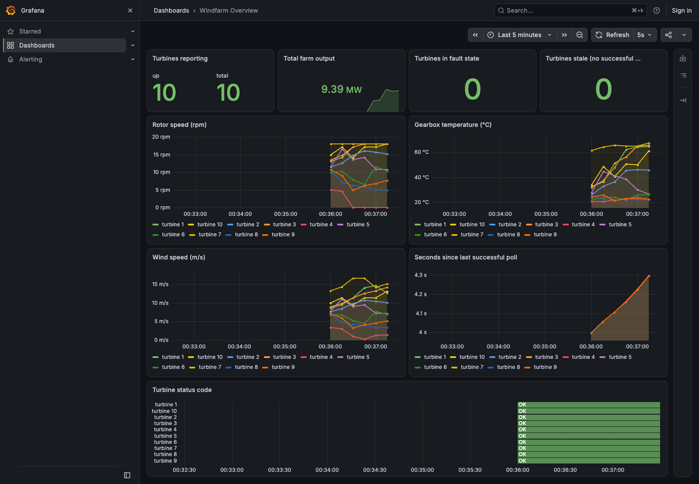
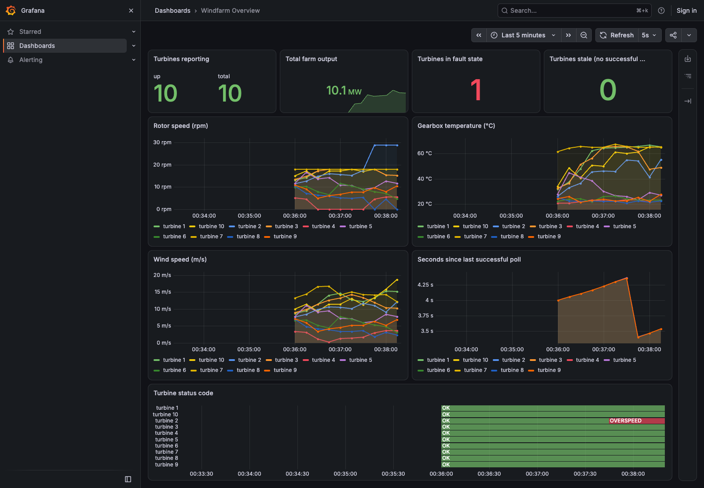
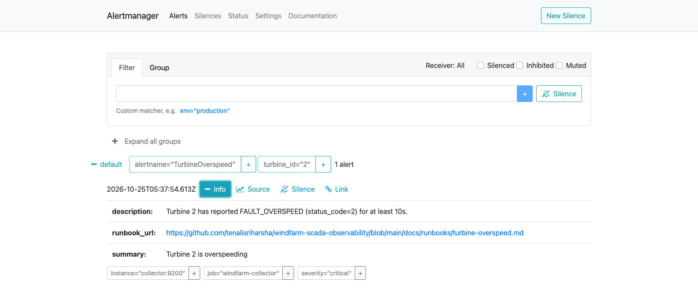
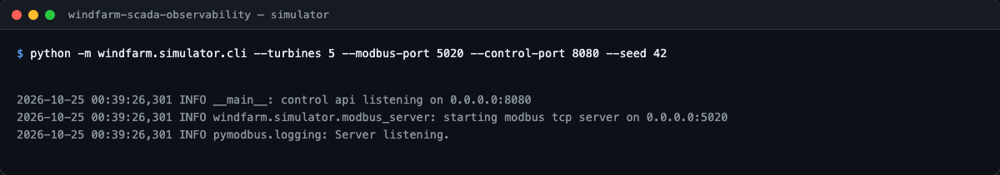
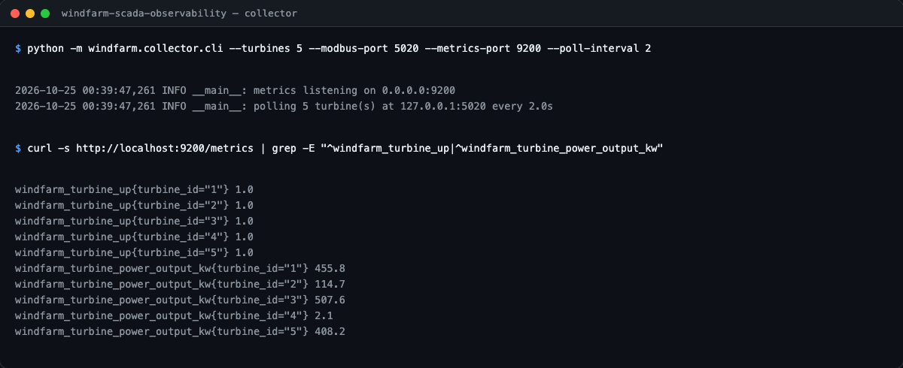
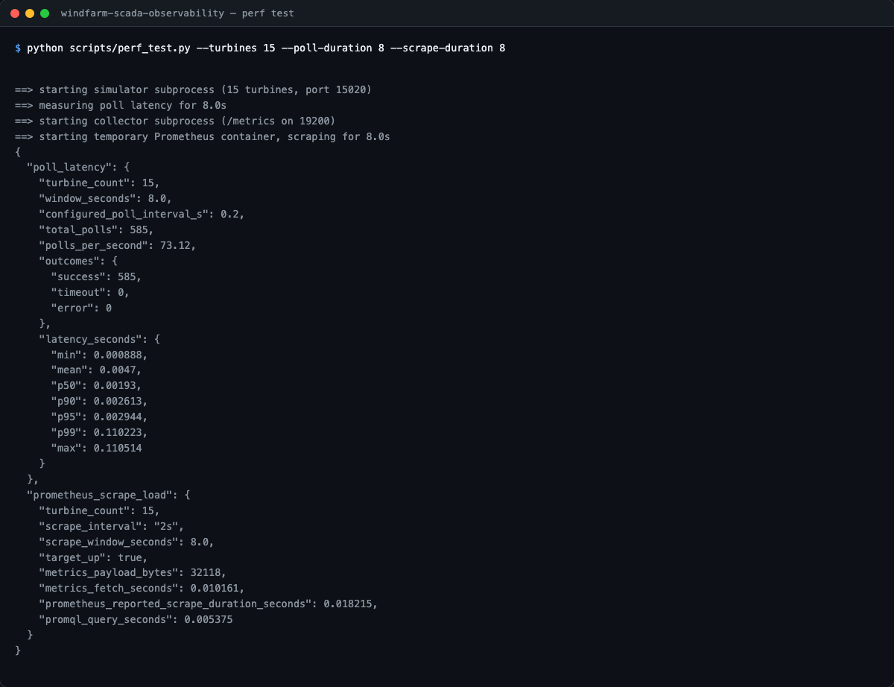

# Windfarm SCADA Observability

[](https://github.com/tenalisriharsha/windfarm-scada-observability/actions/workflows/ci.yml)

A simulated wind farm SCADA environment for learning and demonstrating
industrial-monitoring patterns: Modbus TCP turbine simulators, a strictly
read-only polling collector, and a Prometheus/Grafana/Alertmanager/Loki
observability stack driven entirely by code.

**This is a simulation.** No real turbines, PLCs, or OT equipment are
involved anywhere in this repository.

It exists to show, end to end, how a SCADA-style telemetry pipeline should
be built when reliability matters: per-request timeouts, retry with
backoff, stale-data detection, metrics that reflect reachability (not just
the last value seen), and alerting tied to runbooks instead of bare
thresholds.

## Preview

| | |
| --- | --- |
| **Grafana — healthy farm** (10/10 turbines up, 0 faults) | **Grafana — overspeed fault injected** (turbine 2 red-flagged, rotor speed spike) |
|  |  |

**Alertmanager — `TurbineOverspeed` firing**, with description, summary, and a link to the runbook:



| **Simulator startup** | **Collector polling + live metrics** |
| --- | --- |
|  |  |

**`scripts/perf_test.py`** driving real poll latency and Prometheus scrape-load measurements:



## Quick start

### Full observability stack (docker compose)

Requires Docker with Compose v2.

```bash
docker compose up -d --build
```

This builds and starts 10 simulated turbines, the collector, Prometheus,
Alertmanager, Grafana, and Loki/Promtail:

| Service      | URL                                        |
| ------------ | ------------------------------------------- |
| Grafana      | http://localhost:3000 (admin / admin)       |
| Prometheus   | http://localhost:9090                       |
| Alertmanager | http://localhost:9093                       |
| Collector    | http://localhost:9200/metrics               |
| Control API  | http://localhost:8080                       |

Inject a fault and watch it propagate through metrics, the Grafana
dashboard, and -- within a few seconds -- a firing Alertmanager alert with
a linked runbook:

```bash
curl -X POST http://localhost:8080/turbines/2/faults \
  -H 'Content-Type: application/json' \
  -d '{"type": "overspeed", "duration_s": 60}'
```

Run `scripts/compose_smoke_test.sh` to do this automatically end to end
(builds, waits for metrics to flow, injects a fault, polls Alertmanager
until it fires, tears everything down).

Tear the stack down with `docker compose down`.

### Running the Python pieces directly

Requires Python 3.11+.

```bash
python3 -m venv .venv
source .venv/bin/activate
pip install -e ".[dev]"

# terminal 1: run 5 simulated turbines
python -m windfarm.simulator.cli --turbines 5 --modbus-port 5020 --control-port 8080

# terminal 2: poll them and export Prometheus metrics
python -m windfarm.collector.cli --turbines 5 --modbus-port 5020 --metrics-port 9200
curl http://localhost:9200/metrics | grep windfarm_turbine_up

# terminal 3: inject a fault and watch it show up in the metrics
curl -X POST http://localhost:8080/turbines/2/faults \
  -H 'Content-Type: application/json' \
  -d '{"type": "overspeed", "duration_s": 30}'
```

Run the test suite with `pytest`. Run the end-to-end compose smoke test
(the same check CI runs as its integration gate) with
`scripts/compose_smoke_test.sh`. Run the 50-turbine latency/scrape-load
measurement with `scripts/perf_test.py` -- see
[docs/performance.md](docs/performance.md) for real measured numbers from
that script.

## How it works

- **Simulator** (`windfarm.simulator`) runs a wind-driven power curve and a
  gearbox thermal model per turbine, serves the results over Modbus TCP (one
  gateway process, each turbine addressed by its own Modbus unit id), and
  exposes a small HTTP control API for injecting faults: overspeed,
  overheating, or a comm-loss that makes the simulator stop responding to
  that turbine entirely.
- **Collector** (`windfarm.collector`) is read-only -- it only ever calls
  `read_holding_registers`. Each turbine gets its own poll loop with a
  per-request timeout, exponential-backoff retries, and a `last_seen_age`
  gauge that keeps climbing even between polls, so a silent turbine is
  visible well before an alert fires.
- **Shared register map** (`windfarm.common`) is the single source of truth
  for the Modbus wire format, imported by both sides so they can't drift
  out of sync.
- **Observability stack** (`docker-compose.yml`, `docker/`) wires the
  collector's `/metrics` into Prometheus, which evaluates three alert
  rules -- turbine overspeed, gearbox overheat, and a turbine gone silent
  -- each annotated with a link to a runbook under
  [`docs/runbooks/`](docs/runbooks/). Alertmanager receives the firing
  alerts, Grafana renders a provisioned-as-code dashboard, and
  Promtail/Loki collect container logs. Nothing here is clicked together
  by hand: datasources, dashboards, and alert rules are all files in this
  repo.
- **Performance** (`scripts/perf_test.py`, [docs/performance.md](docs/performance.md))
  measures real poll latency (driving the collector's actual poll code
  against a real simulator subprocess) and real Prometheus scrape load
  (a temporary Prometheus container scraping a real collector process),
  with the raw results from a 50-turbine run checked in for reference.
- **OT security design notes** ([docs/ot-security.md](docs/ot-security.md))
  frame the simulator/collector split as IEC 62443 zones and conduits,
  and explain why the collector's Modbus path is strictly read-only.

## Status

All core phases are complete and passing: the simulator, the read-only
collector, the docker-compose observability stack (Prometheus, Grafana,
Alertmanager, Loki, alert rules with runbooks), the 50-turbine
performance measurement, the OT-security design notes, and CI (unit
tests plus the compose smoke test as an integration gate). See
[PROGRESS.md](PROGRESS.md) for the phase-by-phase build history.

## License

MIT -- see [LICENSE](LICENSE).
